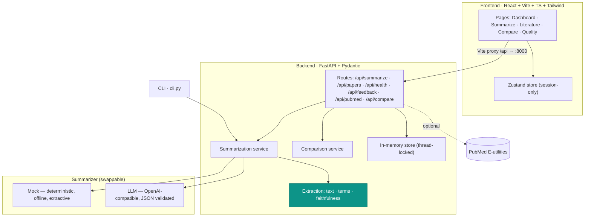

# MedSynth — Medical Literature, Synthesized

> **From Medical Literature to Meaning.**
> An AI-assisted tool that turns a medical abstract into a faithful, structured, source-grounded summary — and shows *how much* of that summary is actually supported by the source.

Built for the **TCS Technology Day — Life Sciences track**.

**Guiding principle:** *Summarize the literature, but never invent what the literature says.*
MedSynth never fabricates facts, sample sizes, p-values, authors, citations, limitations, or recommendations. Anything absent from the source is rendered explicitly as **"Not stated in the provided abstract."** Every summary distinguishes **[FROM SOURCE]** content from **[AI INTERPRETATION]**.

> ⚠️ MedSynth summarizes scientific literature and is **not a substitute for professional medical judgment or clinical advice.**

---

## Highlights

- **4 summary modes** — Concise, Structured, Clinician, Researcher (each emphasizes different fields).
- **3 lengths** — Short / Medium / Detailed (these genuinely change what is generated, not just truncation).
- **3 input methods** — paste text, upload `.txt`, or fetch from **PubMed** by PMID / search.
- **Source Alignment** — a transparent faithfulness *indicator* (High / Moderate / Low), blending numeric grounding, term overlap, and coverage. Explicitly **not** called an accuracy score.
- **Side-by-side view** — original vs. summary with matched numbers and key terms highlighted.
- **Batch processing** — queue many abstracts, "Process All" with live progress, export CSV / JSON / Markdown.
- **Multi-paper comparison** — contrast 2–5 papers in a neutral matrix (common findings, differences, conflicts, research gaps).
- **Feedback** — 4-dimension star ratings, session-only.
- **Runs 100% offline** in deterministic **mock** mode — no API key, no network, no database.
- **Configurable LLM** — flip to `api` mode (OpenAI-compatible) via `.env`; output is validated with Pydantic.
- Light default + dark mode, clinical teal/indigo palette, Inter font.

---

## Architecture



The **same summarization service** backs the web API and the CLI — no duplicated logic. The engine (mock vs. LLM) is selected at runtime from `.env`.

---

## Project structure

```
medsynth/
├── README.md
├── samples/                     # Synthetic demo abstracts (oncology / cardiology / diabetes)
├── backend/
│   ├── .env.example             # Copy to .env — defaults run fully offline
│   ├── requirements.txt
│   ├── cli.py                   # Command-line summarizer (same service as the API)
│   ├── tests/test_api.py
│   └── app/
│       ├── main.py              # FastAPI entrypoint (CORS, routers, error handler)
│       ├── config.py            # Settings from env (LLM_MODE, keys, CORS…)
│       ├── models/              # Pydantic schemas + API request/response models
│       ├── routes/              # summarize · papers · core (health/feedback/pubmed/compare)
│       └── services/
│           ├── summarization/   # base · mock · llm · prompts · service
│           ├── extraction/      # text · terms · faithfulness (Source Alignment)
│           ├── comparison.py    # neutral multi-paper comparison
│           ├── pubmed/          # E-utilities client
│           └── store.py         # in-memory, thread-locked session store
└── frontend/
    ├── index.html · vite.config.ts · tailwind.config.js · tsconfig.json
    └── src/
        ├── main.tsx · App.tsx   # Router: Dashboard/Summarize/Literature/Compare/Quality
        ├── pages/               # one file per route
        ├── components/          # layout · shared · summary · ui (shadcn-style primitives)
        ├── store/useStore.ts    # Zustand global (session-only)
        ├── lib/ · hooks/ · data/ · types/
        └── index.css            # HSL CSS-variable theming (light/dark)
```

---

## Run it

### 1. Backend (FastAPI, port 8000)

```bash
cd medsynth/backend
python -m venv venv
# Windows: venv\Scripts\activate     |     macOS/Linux: source venv/bin/activate
pip install -r requirements.txt
cp .env.example .env          # defaults = offline mock mode, no key needed
python -m uvicorn app.main:app --reload --port 8000
```

- API root: <http://localhost:8000>
- Interactive docs (Swagger): <http://localhost:8000/docs>
- Health: <http://localhost:8000/api/health>

### 2. Frontend (React + Vite, port 5173)

```bash
cd medsynth/frontend
npm install
npm run dev
```

- App: <http://localhost:5173>
- The Vite dev server proxies `/api` → `http://localhost:8000`, so no CORS setup is needed in dev.

### 3. CLI (optional — same engine as the API)

```bash
cd medsynth/backend
python cli.py --file ../samples/oncology.txt
python cli.py --file ../samples/cardiology.txt --mode clinician --length short
python cli.py --pmid 25760099
python cli.py --text "Background: ..."
```

---

## Configuration (`backend/.env`)

| Variable | Default | Purpose |
|---|---|---|
| `LLM_MODE` | `mock` | `mock` = offline & deterministic; `api` = OpenAI-compatible provider |
| `LLM_API_KEY` | *(empty)* | Provider key (only used in `api` mode) |
| `LLM_BASE_URL` | `https://api.openai.com/v1` | OpenAI-compatible endpoint |
| `LLM_MODEL` | `gpt-4o-mini` | Model name for `api` mode |
| `LLM_TIMEOUT` | `60` | Request timeout (seconds) |
| `LLM_MAX_INPUT_CHARS` | `24000` | Source cap before chunking |
| `PUBMED_EMAIL` / `PUBMED_API_KEY` | *(empty)* | Optional — better PubMed rate limits/etiquette |
| `FRONTEND_ORIGIN` | `http://localhost:5173,http://127.0.0.1:5173` | Allowed CORS origins |

**Everything works with the defaults** — mock mode requires no key and no network. No secrets are committed; `.env` is git-ignored.

### Mock vs. API mode

- **Mock (default):** a deterministic, explainable **extractive** summarizer. It parses sections, ranks sentences, preserves numbers verbatim, and fills unknowns with the placeholder. Same input → same output, every time. Ideal for offline demos.
- **API:** sends a structured prompt to an OpenAI-compatible model and validates the returned JSON against Pydantic schemas. Malformed or fabricated-shaped output is rejected rather than shown.

Both engines flow through the identical Source-Alignment check, so faithfulness signals are computed the same way regardless of engine.

---

## Testing

```bash
cd medsynth/backend
python -m pytest            # backend API + service tests
```

```bash
cd medsynth/frontend
npm run build               # tsc --noEmit + vite production build
```

---

## Limitations (stated honestly)

- **Source Alignment is a heuristic indicator, not a validated accuracy metric.** High alignment means the summary is well-grounded in the source's numbers/terms — it does *not* certify clinical correctness.
- **Abstract-level, single-document.** MedSynth summarizes the text you give it; it does not judge study quality, external validity, or the broader evidence base.
- **No persistence.** All state (papers, ratings, feedback) is in-memory and session-only by design — refreshing or restarting clears it. No database, no patient data, no PHI.
- **Mock mode is extractive**, not generative: it recombines and ranks source sentences rather than writing novel prose. This is intentional — it cannot hallucinate.
- **PubMed** depends on NCBI availability and rate limits; provide `PUBMED_EMAIL`/`PUBMED_API_KEY` for reliability.
- **Not medical advice.** MedSynth is a literature-reading aid, not a clinical decision tool.
```